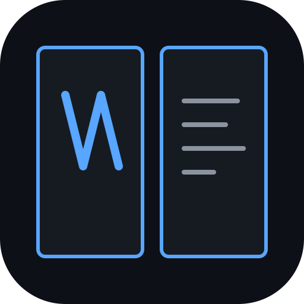

# Markdown Looker

<p align="center">
  
</p>

一个极简、优雅、且拥有**极致丝滑左右双向滚动同步**的本地 Markdown 桌面编辑器。

基于 Tauri + Vite + 原生前端技术栈构建，拥有极低的大小、内存占用和原生的性能体验。

## 核心特性

- **极致丝滑的滚动同步**：移植并重构了 [markups](https://github.com/Nir-Bhay/markups) 的源码行号（`data-source-line`）锚点映射算法，无论快速拖拽还是慢速滚动，左右两侧都能完美对齐，告别滚轮漂移。
- **强大的编辑器底座**：左侧采用 VS Code 同款的 **Monaco Editor**，提供顶级的 Markdown 语法高亮和编辑体验。
- **内置 Markdown 工具栏**：标签页下方提供一整条 Markdown 快捷工具栏，分为五组，覆盖常用写作操作：
  - **行内格式**：加粗、斜体、删除线、行内代码、文本高亮。仅在编辑器存在非空选区时可用。
  - **标题**：H1 - H6，对选区覆盖的每一行行首直接追加 `#` 前缀。
  - **列表**：无序列表、有序列表（按非空行自动编号）、任务列表（`- [ ] ` / `- [x] ` 逐行切换）。
  - **插入**：链接、图片、表格、代码块。表格与警示块使用类似主题二级菜单的下拉面板，直接弹在按钮下方，无黑色遮罩。
  - **块级**：引用、警示块（NOTE / TIP / IMPORTANT / WARNING / CAUTION）、分割线。

  所有操作均为**单步撤销**，且只作用于左侧编辑器，不会误改预览区。
- **多标签页**：支持多文件标签切换，每个标签右侧带关闭按钮。标签名后会显示未保存标记（●）。
- **未保存保护**：关闭标签或关闭窗口时，若存在未保存文件，会逐个弹出「保存 / 取消」确认框。任一环节点「取消」即中止整个关闭流程。
- **全功能渲染支持**：
  - 支持 **Mermaid** 流程图/时序图渲染，支持「一键复制代码」和「全屏查看」。
  - 支持 **KaTeX** 数学公式渲染（`$ ... $` 与 `$$ ... $$`）。
  - 支持 **Shiki** 代码块语法高亮，深浅主题切换零重新渲染，代码块右上角自带「一键复制」按钮。
  - 支持 GitHub 风格的 Alert 警告块（NOTE, TIP, WARNING 等）。
- **导出为单文件 HTML**：菜单栏「导出 → HTML」提供深色 / 浅色两个选项，把**当前标签页**的渲染结果原样导出为一个自包含 HTML 文件。
  - 导出内容 = 用户此刻看到的预览，Mermaid 图、Shiki 高亮、KaTeX 公式、GitHub Alert 全部保留。
  - 样式（`style.css` + `katex.min.css`）以字符串内嵌，脱离原目录双击即可打开。
  - 深色 / 浅色按所选模式固化到 `<html class="light">`，不依赖系统主题。
  - 自动剔除仅供软件内交互的按钮（代码复制、Mermaid 全屏）和 `data-source-line` 锚点。
  - 本地图片（`asset:` 协议）尝试转为 data URL 内嵌，失败则保留原路径，不中断导出。
- **轻量级代码高亮**：
  - 内置 9 种常用语言（Java、C、C++、Python、Rust、JavaScript、HTML、CSS、Markdown），打包进主程序，首屏零闪烁。
  - 其余语言通过 exe 同级 `langs/` 目录按需加载，按实际使用选择性放入语法文件，不占打包体积。
- **轻量级桌面应用**：打包生成的 `.exe` 体积小巧，启动迅速，原生支持文件关联（双击 `.md` 文件直接打开）。
- **主题**：支持跟随系统 / 深色 / 浅色三种模式，自动记忆到本地存储与 Tauri 配置文件。
- **可视化设置窗口**：独立的设置界面，按面板动态加载，修改即时写入 `config.json`：
  - **外观**：主题三选一、渲染模式（双栏 / 预览 / 源码）、设置窗口大小（相对主窗口的百分比，拖动实时预览）。
  - **图床**：插入图片行为（本地 / 云端），本地支持固定位置 / 相同目录 / 子目录三种策略，云端集成 [PicNexus](https://github.com/littlecode/PicNexus) CLI。
  - **快捷键**：表格化管理所有动作的快捷键，支持编辑、重置、解绑，可录制多段序列（如 `Ctrl+K Ctrl+S`），并做冲突检测。

## 技术栈

本项目采用前后端分离的现代化桌面开发架构：

### 前端 (Frontend)
- **构建工具**: [Vite](https://vitejs.dev/) (极致的前端构建体验)
- **核心语言**: 原生 JavaScript (ES Modules)
- **编辑器引擎**: [Monaco Editor](https://microsoft.github.io/monaco-editor/)
- **Markdown 解析**:
  - [Marked](https://marked.js.org/) (核心解析器)
  - `marked-katex-extension` (数学公式扩展)
  - `marked-alert` (GitHub 警告块扩展)
  - `marked-footnote` (脚注扩展)
  - `marked-gfm-heading-id` (标题锚点)
- **图表与公式**: [Mermaid](https://mermaid.js.org/) & [KaTeX](https://katex.org/)
- **代码高亮**: [Shiki](https://shiki.style/) (基于 TextMate 语法的精确高亮，支持深浅双主题)
- **安全过滤**: [DOMPurify](https://github.com/cure53/DOMPurify) (防止 XSS 注入)
- **UI 样式**: 原生 CSS 变量 (支持深色/浅色主题无缝切换)

### 后端与打包 (Backend & Bundler)
- **桌面框架**: [Tauri (v2)](https://tauri.app/)
- **后端语言**: [Rust](https://www.rust-lang.org/)
- **系统交互**: 通过 Tauri IPC 实现原生的文件读写、系统对话框调用、窗口主题控制、窗口关闭拦截，以及额外语言语法文件的按需读取。

## 项目结构

```text
markdown-looker/
├── .github/
│   └── workflows/
│       └── build-macos.yml       # macOS 云端构建（Ad-hoc 签名 Universal dmg）
├── src/                          # 前端源码目录
│   ├── core/                     # 核心逻辑
│   │   ├── scroll-sync.js        # 双向滚动同步核心算法
│   │   ├── source-lines.js       # Markdown 块级行号锚点提取
│   │   ├── sanitize.js           # HTML 安全过滤
│   │   ├── debounce.js           # 性能防抖
│   │   ├── eventBus.js           # 事件总线
│   │   └── shiki-highlighter.js  # Shiki 高亮器（内置语言 + 额外语言按需加载）
│   ├── settings/                 # 设置窗口各面板（按需动态 import）
│   │   ├── appearance.js         # 外观：主题 / 渲染模式 / 设置窗口大小
│   │   ├── imagehost.js          # 图床：本地保存 / PicNexus
│   │   └── shortcuts.js          # 快捷键
│   ├── toolbar.js                # Markdown 工具栏逻辑
│   ├── toolbar-icons.js          # 工具栏图标
│   ├── settings.js               # 设置窗口入口：导航 + 面板挂载
│   ├── main.js                   # 应用入口，串联 Monaco 与 Markdown 渲染
│   └── style.css                 # 全局 UI 与 Markdown 渲染样式
├── src-tauri/                    # Tauri (Rust) 后端目录
│   ├── src/                      # Rust 源码
│   │   ├── lib.rs                # 入口与命令注册
│   │   └── grammar.rs            # 从 exe 同级 langs/ 读取语法文件
│   ├── capabilities/
│   │   └── default.json          # 窗口权限（关闭、主题等）
│   ├── Cargo.toml                # Rust 依赖配置
│   ├── tauri.conf.json           # Tauri 基础配置（Windows 裸 exe）
│   └── tauri.macos.conf.json     # macOS 平台覆盖（bundle + Ad-hoc 签名 + 文件关联）
├── scripts/
│   └── sync-version.mjs          # 版本号同步脚本
├── index.html                    # 主页面 HTML 骨架
├── settings.html                 # 设置窗口 HTML 骨架
├── package.json                  # 前端依赖与脚本
├── vite.config.js                # Vite 配置
├── build.bat                     # Windows 本地一键编译（裸 exe）
└── build-macos.bat               # macOS：触发云端构建 + 拉取 .dmg
```

打包完成后，如果希望启用额外语言高亮，需要在 exe 同级目录创建 `langs/` 文件夹（详见下文「代码高亮与额外语言」）：

```text
markdown-looker.exe
langs/
  go.tmLanguage.json
  ruby.tmLanguage.json
  bash.tmLanguage.json
  ...
```

## 开发与构建

### 环境准备
请确保你已安装：
1. [Node.js](https://nodejs.org/) (推荐 v18+)
2. [Rust](https://www.rust-lang.org/tools/install) (通过 rustup 安装)
3. [Tauri CLI](https://tauri.app/v1/guides/getting-started/prerequisites)

### 安装依赖
```bash
npm install
```

### 本地开发调试
```bash
# 启动纯前端浏览器预览 (推荐用于调试 UI 和同步逻辑)
npm run dev

# 启动 Tauri 桌面端热更新开发
npm run tauri dev
```

### 生产环境构建

Windows 与 macOS 的构建入口不同：

- **Windows**：双击根目录 `build.bat`，本地执行 `tauri build` 并复制裸 exe 到 `D:\software\markdown looker`。需全局安装 Tauri CLI（`cargo install tauri-cli` 或 `npm i -g @tauri-apps/cli`），因为 `build.bat` 调用的是 `tauri build` 而非 `npm run tauri build`。
- **macOS**：双击根目录 `build-macos.bat`，触发 GitHub Actions 的 `build-macos.yml` 云端构建，完成后自动把 **Ad-hoc 签名的 Universal `.dmg`** 拉取到 `D:\software\markdown looker\macOS`。Tauri 无法在 Windows 上交叉编译 macOS 应用，所以必须走云端。

基础配置 `src-tauri/tauri.conf.json` 中 `bundle.active` 为 `false`，因此 Windows 侧构建产物就是一个裸 exe，不需要 WiX / NSIS 工具链。macOS 侧由 `src-tauri/tauri.macos.conf.json` 覆盖为 `bundle.active: true`，产出 `.app` 与 `.dmg`。

构建产物路径：

```
src-tauri/target/release/markdown-looker.exe          # Windows（本地 build.bat）
src-tauri/target/universal-apple-darwin/release/bundle/dmg/*.dmg   # macOS（云端 CI）
```

`Cargo.toml` 的 crate 名决定了 exe 文件名，无法包含空格，因此产物名为 `markdown-looker.exe`（连字符）。如需带空格的名字，在复制到目标目录时改名即可。

### 一键构建（Windows）

根目录的 `build.bat` 封装了完整流程：

1. 结束可能占用 `markdown-looker.exe` 的残留进程；
2. 执行 `tauri build`（全局 Tauri CLI，非 `npm run tauri build`）；
3. 编译成功后，把 `src-tauri\target\release\markdown-looker.exe` 复制到 `D:\software\markdown looker\markdown-looker.exe`（目标目录不存在会自动创建）。

前置：全局安装 Tauri CLI（`cargo install tauri-cli` 或 `npm i -g @tauri-apps/cli`）。如需修改投放位置，改 `build.bat` 里的 `DEST_DIR` 即可。

## macOS 版本构建（GitHub Actions + Ad-hoc 签名）

Tauri 无法在 Windows 上交叉编译 macOS 应用，macOS 版本通过 GitHub Actions 的 `macos-latest` 运行器构建，产出 **Universal `.dmg`**（同时兼容 Apple Silicon 与 Intel）。

### 两个构建入口

| 入口 | 平台 | 行为 |
| :--- | :--- | :--- |
| `build.bat` | Windows | 本地 `tauri build` → 复制裸 exe 到 `D:\software\markdown looker` |
| `build-macos.bat` | macOS | 触发 GitHub Actions → 等待完成 → 下载 `.dmg` 到 `D:\software\markdown looker\macOS` |

### 平台配置：tauri.macos.conf.json

`src-tauri/tauri.macos.conf.json` 是 Tauri v2 的**平台特定配置**，在 macOS 上构建时自动与基础 `tauri.conf.json` 合并，无需命令行传 `--config`。它覆盖三件事：

- `bundle.active: true`、`targets: ["app", "dmg"]`：基础配置为 Windows 裸 exe 设为 `false`，这里在 macOS 上重新启用打包。
- `bundle.macOS.signingIdentity: "-"`：Ad-hoc 签名。
- `bundle.fileAssociations`：macOS 上双击 `.md` / `.markdown` / `.mdx` / `.txt` 用本应用打开。

### 签名策略：Ad-hoc（免费，无 Apple Developer 账号）

本项目**不购买 Apple Developer Program（99 美元/年）**，因此使用 **Ad-hoc 签名**（`signingIdentity: "-"`）。Ad-hoc 签名不依赖任何付费证书，也**没有 Apple 公证**，但它让 `.app` 拥有合法的 bundle 级代码密封，避免在 Apple Silicon 上被 Gatekeeper 误判为「已损坏」。

首次打开仍可能出现「无法验证开发者」，但**不会出现「已损坏」**，按下方「macOS 首次打开被拦截的解决方案」放行即可，用户门槛远低于无签名包。

### 构建流程

1. 推送代码到 GitHub。
2. 双击根目录 `build-macos.bat`。脚本会：
   - 通过 `gh` 触发 `build-macos.yml`；
   - 等待构建完成；
   - 下载 `.dmg` artifact；
   - 复制到 `D:\software\markdown looker\macOS`。
3. 也可手动在仓库 **Actions → Build macOS (Ad-hoc signed DMG) → Run workflow** 触发，然后重新运行 `build-macos.bat` 或直接到 Actions 页面下载 artifact。

前置：安装 [GitHub CLI](https://cli.github.com/) 并执行 `gh auth login`。

### 为什么 CI 里要验证签名

Tauri 在 `signingIdentity` 缺失时会**静默跳过** codesign 阶段，产出的 `.app` 没有 bundle 级密封，在 Apple Silicon 上会被 Gatekeeper 直接报「已损坏」，`xattr` 都无法恢复。`build-macos.yml` 中显式执行 `codesign --verify --strict`，签名不合法时 CI 立即失败，不会把坏包发出去。

### macOS 首次打开被拦截的解决方案

Ad-hoc 签名已消除「已损坏」错误。若仍提示「无法验证开发者」，任选一种：

**方式一：右键打开（最简单）**
1. Finder 中**右键点击** `Markdown Looker.app` → 打开。
2. 弹窗中再点「打开」。
3. 之后可正常双击启动。

**方式二：系统设置放行**
1. 双击应用 → 弹窗点「完成」。
2. **系统设置 → 隐私与安全性** → 底部找到被拦截提示 → 点「仍要打开」。
3. 输入密码确认。

**方式三：终端去除隔离属性（备用）**
```bash
xattr -cr /Applications/Markdown\ Looker.app
```
仅在个别系统版本仍拦截时使用；Ad-hoc 签名正常时不需要这一步。提示「已损坏」但 App 实际完好时，也可用此命令修复。

**方式四：临时关闭 Gatekeeper（不推荐）**
```bash
sudo spctl --master-disable
```
全局关闭应用来源检查，降低系统安全性，仅在清楚后果时使用。

## 代码高亮与额外语言

代码块高亮基于 [Shiki](https://shiki.style/)，采用 **"内置核心 + 按需扩展"** 的策略：

- **内置语言**（Java、C、C++、Python、Rust、JavaScript、HTML、CSS、Markdown）已在构建时静态导入，无需任何配置，开箱即用。
- **其他语言** 需要在 exe 同级目录放置对应的 TextMate 语法文件（`.tmLanguage.json`）。文件存在则自动加载高亮；文件缺失、损坏或格式错误时，该语言的代码块会静默回退为纯文本，不会报错、不会崩溃。

### 一、语法文件从哪里获取

语法文件的官方来源是 [shikijs/textmate-grammars-themes](https://github.com/shikijs/textmate-grammars-themes) 仓库，也可以从 npm 包 `tm-grammars` 中获取，两者内容一致。

#### 方式一：通过 npm 包获取（推荐）

```bash
npm install tm-grammars --no-save
```

安装后，在 `node_modules/tm-grammars/grammars/` 目录下即可找到所有语言的 `.json` 文件，例如 `go.json`、`ruby.json`、`shellscript.json`、`yaml.json`。

> `--no-save` 表示临时下载，不写入 `package.json`，只用于手动提取文件。

#### 方式二：从 GitHub 直接下载

仓库中语法文件所在的实际路径是：

```
https://github.com/shikijs/textmate-grammars-themes/tree/main/packages/tm-grammars/grammars
```

以 Go 语言为例，Raw 文件地址为：

```
https://raw.githubusercontent.com/shikijs/textmate-grammars-themes/main/packages/tm-grammars/grammars/go.json
```

打开对应的 Raw 页面后，右键「另存为」即可下载。

#### 方式三：从 VS Code 源码提取

`tm-grammars` 中的语法多数源自 VS Code，也可直接从 `microsoft/vscode` 仓库对应语言扩展的 `syntaxes/` 目录获取原始 `.tmLanguage.json` 文件，格式完全兼容。

### 二、文件放置与命名规则

将下载的文件放入 **exe 同级目录下的 `langs/` 文件夹**，并重命名为 `<语言标记>.tmLanguage.json` 格式。文件名中的 `<语言标记>` 必须与 Markdown 代码块中 ` ``` ` 后写的语言名一致。

| Markdown 中写法 | 源文件名 | 放入 `langs/` 后重命名为 |
| :--- | :--- | :--- |
| ` ```go ` | `go.json` | `go.tmLanguage.json` |
| ` ```ruby ` | `ruby.json` | `ruby.tmLanguage.json` |
| ` ```bash ` | `shellscript.json` | `bash.tmLanguage.json` |
| ` ```json ` | `json.json` | `json.tmLanguage.json` |
| ` ```yaml ` | `yaml.json` | `yaml.tmLanguage.json` |

注意：`bash` 在 `tm-grammars` 中的原始文件名是 `shellscript.json`，需要特别留意重命名。

### 三、常见别名

Shiki 高亮器内置了一张别名映射表，以下写法可直接识别为对应语言，无需重复放置语法文件：

| Markdown 中写法 | 实际加载语言 |
| :--- | :--- |
| `js` | `javascript` |
| `py` | `python` |
| `md` | `markdown` |
| `c++` / `cxx` | `cpp` |
| `h` | `c` |
| `hpp` | `cpp` |
| `sh` / `shell` | `bash` |
| `htm` | `html` |

### 四、行为说明

| 场景 | 行为 |
| :--- | :--- |
| 内置 9 种语言 | 首帧高亮，零闪烁 |
| 额外语言，`langs/` 存在对应文件 | 首帧纯文本，文件读取完成后替换为高亮 |
| 额外语言，`langs/` 缺失文件 | 永久纯文本，不报错 |
| 额外语言，JSON 损坏或格式不合法 | 永久纯文本，控制台输出警告 |
| 浏览器环境（`npm run dev`） | 仅内置 9 种语言高亮，额外语言全部回退纯文本 |
| 深浅主题切换 | 不重新高亮，仅通过 CSS 变量切换颜色 |

## 快捷键

| 快捷键 | 功能 |
| :--- | :--- |
| `Ctrl + O` | 打开文件 |
| `Ctrl + S` | 保存当前标签 |
| `Ctrl + Shift + S` | 另存为 |
| `Esc` | 关闭 Mermaid 全屏 / 关闭保存确认弹窗 |

> 除默认快捷键外，所有动作均可通过「设置 → 快捷键」重新绑定，支持多段序列（如 `Ctrl+K Ctrl+S`），并区分左右修饰键和小键盘主键。

## 致谢

- 感谢 [Nir-Bhay/markups](https://github.com/Nir-Bhay/markups) 项目提供的滚动同步解决方案。
- 感谢 [Shiki](https://shiki.style/) 与 [textmate-grammars-themes](https://github.com/shikijs/textmate-grammars-themes) 提供的语法与主题资源。

## License

MIT License