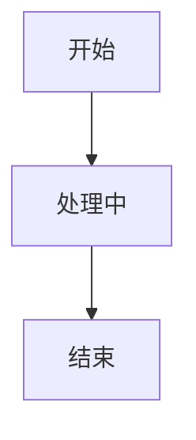
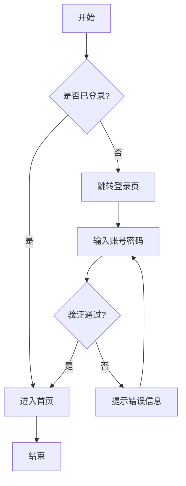
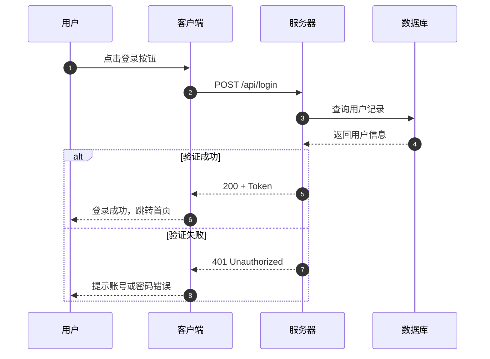
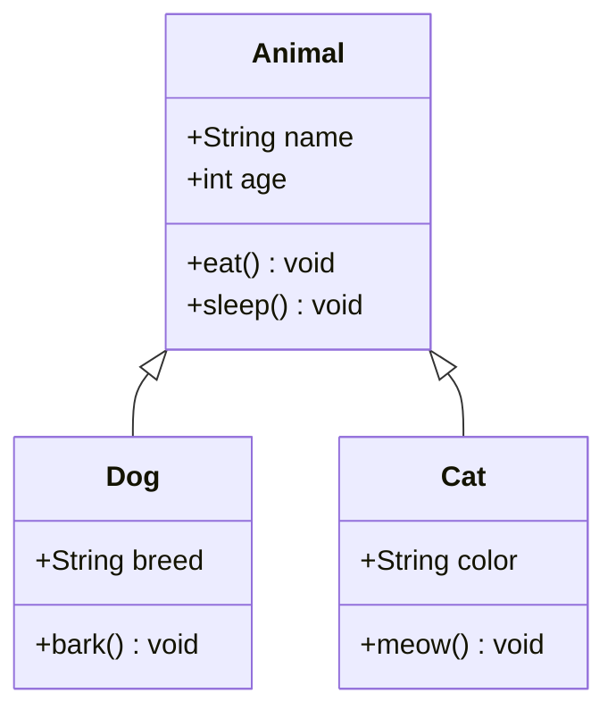
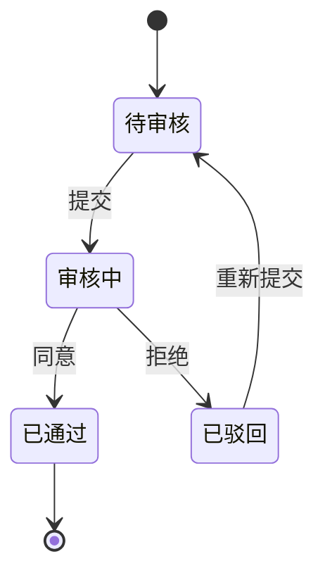
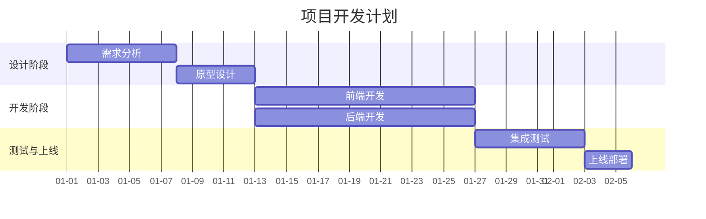
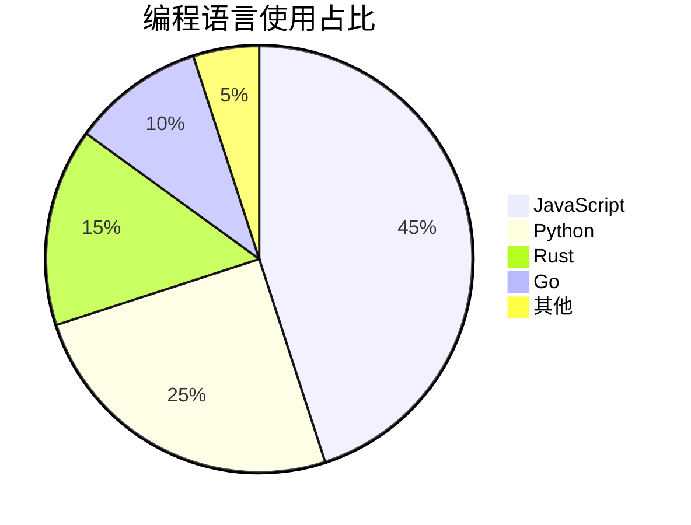
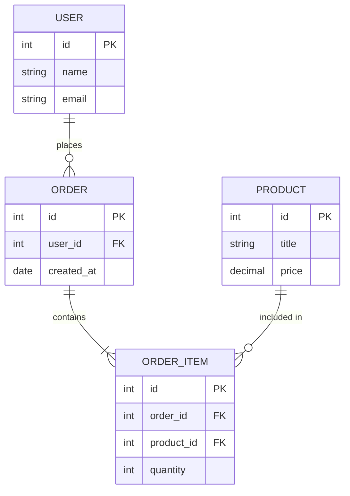
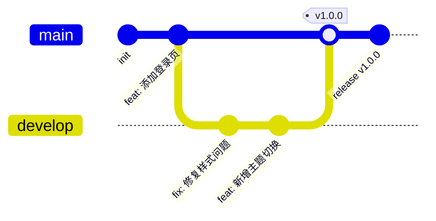

# GitHub Flavored Markdown 完整语法测试

这是一段普通文本，用来展示 **加粗**、*斜体*、~~删除线~~ 以及 `行内代码` 的效果。

本文件同时测试 **Mermaid 流程图** 与 **LaTeX 数学公式** 的渲染效果。

---

## 1. 链接

**链接测试：**
* [点击访问 GitHub](https://github.com)
* 自动链接测试：直接输入网址 https://github.com 应该也能被识别。

---

## 2. 列表支持

### 无序列表
- 苹果
- 香蕉
  - 嵌套的子项 1
  - 嵌套的子项 2
- 橘子

### 有序列表
1. 第一步：打开电脑
2. 第二步：写代码
   1. 写 HTML
   2. 写 CSS
3. 第三步：运行

### 任务列表 (Task List)
- [x] 已完成的任务
- [ ] 未完成的任务
- [ ] 还需要测试一下

---

## 3. 表格 (Tables)
GitHub 支持带对齐方式的表格：

| 左对齐 (默认) | 居中对齐 | 右对齐 | 包含代码 |
| :--- | :---: | ---: | :--- |
| 数据 A | `Code` | 100 | **加粗** |
| 数据 B | Text | 200 | *斜体* |
| 数据 C | Link | 300 | [链接](https://github.com) |

---

## 4. 代码块 (Code Blocks)
带语法高亮的代码块：

```javascript
function test() {
  console.log("Hello, Comrak!");
  return true;
}
```

```python
def hello():
    print("Hello from Python")

hello()
```

---

## 5. 引用 (Blockquotes)

> 这是一个普通的引用。
> 它可以有多行。

> 包含 **加粗** 和 [链接](https://github.com) 的引用。

---

## 6. HTML 折叠块 (Details / Summary)
*（注意：GitHub 规范要求在 `<summary>` 后，以及 `</details>` 前保留空行，内部的 Markdown 才会被正确解析）*

<details>
<summary>点击展开查看详细说明 👈</summary>

这里是隐藏的内容。它是完全支持 Markdown 语法的：
* 列表项
* [这是一个链接](https://github.com)
* 还有 `行内代码`

</details>

<details>
<summary>1.21.x</summary>

* [example.com](example.com)
* [example.com](example.com)
* [example.com](example.com)

</details>

---

## 7. GFM 警告提示块 (Alerts)
*（GitHub 独有的提示块语法，Comrak 也支持）*

> [!NOTE]
> 这是一个 Note 提示块。

> [!TIP]
> 这是一个 Tip 提示块。

> [!IMPORTANT]
> 这是一个 Important 提示块。

> [!WARNING]
> 这是一个 Warning 警告块。

> [!CAUTION]
> 这是一个 Caution 危险块。

---

## 8. 流程图与图表 (Mermaid)

*（语法：使用 ` ```mermaid ` 代码块，由 Mermaid 引擎在预览侧渲染，支持深浅主题自动切换）*

8.0 简单流程图


### 8.1 流程图 (Flowchart)



### 8.2 时序图 (Sequence Diagram)



### 8.3 类图 (Class Diagram)



### 8.4 状态图 (State Diagram)



### 8.5 甘特图 (Gantt)



### 8.6 饼图 (Pie)



### 8.7 实体关系图 (ER Diagram)



### 8.8 Git 提交图 (Git Graph)



---

## 9. 数学公式 (MathJax / LaTeX)

*（支持行内 `$...$`、块级 `$$...$$`，以及 ` ```math ` 代码块）*

### 9.1 行内公式

质能方程 $E = mc^2$ 是物理学中最著名的公式之一；勾股定理 $a^2 + b^2 = c^2$ 在几何中随处可见；而 $\sum_{i=1}^{n} i = \frac{n(n+1)}{2}$ 则展示了等差数列求和的美妙。

### 9.2 块级公式

高斯积分：

$$
\int_{-\infty}^{\infty} e^{-x^2} \, dx = \sqrt{\pi}
$$

欧拉恒等式：

$$
e^{i\pi} + 1 = 0
$$

### 9.3 多行对齐 (aligned)

麦克斯韦方程组：

$$
\begin{aligned}
\nabla \cdot \vec{E} &= \frac{\rho}{\varepsilon_0} \\
\nabla \cdot \vec{B} &= 0 \\
\nabla \times \vec{E} &= -\frac{\partial \vec{B}}{\partial t} \\
\nabla \times \vec{B} &= \mu_0 \vec{J} + \mu_0 \varepsilon_0 \frac{\partial \vec{E}}{\partial t}
\end{aligned}
$$

### 9.4 矩阵

$$
A = \begin{pmatrix}
a_{11} & a_{12} & a_{13} \\
a_{21} & a_{22} & a_{23} \\
a_{31} & a_{32} & a_{33}
\end{pmatrix},
\quad
\det(A) = \sum_{\sigma \in S_n} \operatorname{sgn}(\sigma) \prod_{i=1}^{n} a_{i,\sigma(i)}
$$

### 9.5 极限与求和

$$
\lim_{n \to \infty} \left(1 + \frac{1}{n}\right)^n = e
$$

$$
\sum_{k=1}^{n} k^3 = \left(\frac{n(n+1)}{2}\right)^2
$$

### 9.6 分式与根式（求根公式）

$$
x = \frac{-b \pm \sqrt{b^2 - 4ac}}{2a}
$$

### 9.7 希腊字母与常见符号

小写：$\alpha, \beta, \gamma, \delta, \epsilon, \varepsilon, \zeta, \eta, \theta, \lambda, \mu, \pi, \rho, \sigma, \phi, \varphi, \omega$

大写：$\Gamma, \Delta, \Theta, \Lambda, \Xi, \Pi, \Sigma, \Phi, \Omega$

关系与运算：$\in, \notin, \subset, \subseteq, \cup, \cap, \forall, \exists, \Rightarrow, \Leftrightarrow, \approx, \equiv, \propto, \infty$

### 9.8 表格中的行内公式

| 公式 | 名称 |
| :--- | :--- |
| $E = mc^2$ | 质能方程 |
| $a^2 + b^2 = c^2$ | 勾股定理 |
| $e^{i\pi} + 1 = 0$ | 欧拉恒等式 |
| $\int_a^b f(x)\,dx$ | 定积分 |
| $\nabla \times \vec{B} = \mu_0 \vec{J}$ | 安培环路定理（静态形式） |

### 9.9 块级公式（傅里叶变换 / 热传导方程）

$$
f(x) = \int_{-\infty}^{\infty} \hat{f}(\xi) \, e^{2\pi i \xi x} \, d\xi
$$

$$
\frac{\partial u}{\partial t} = \alpha \frac{\partial^2 u}{\partial x^2}
$$

### 9.10 综合示例

$$
\left( \frac{a}{b} \right)^2 + \sqrt[n]{x} = \vec{v} \cdot \vec{w} + \hat{n} \times \vec{F}
$$

---

## 10. 其他元素

分割线：
---
连续的三个破折号会在上方生成一条线。
# GitHub Flavored Markdown 完整语法测试

这是一段普通文本，用来展示 **加粗**、*斜体*、~~删除线~~ 以及 `行内代码` 的效果。

本文件同时测试 **Mermaid 流程图** 与 **LaTeX 数学公式** 的渲染效果。

---

## 1. 链接

**链接测试：**
* [点击访问 GitHub](https://github.com)
* 自动链接测试：直接输入网址 https://github.com 应该也能被识别。

---

## 2. 列表支持

### 无序列表
- 苹果
- 香蕉
  - 嵌套的子项 1
  - 嵌套的子项 2
- 橘子

### 有序列表
1. 第一步：打开电脑
2. 第二步：写代码
   1. 写 HTML
   2. 写 CSS
3. 第三步：运行

### 任务列表 (Task List)
- [x] 已完成的任务
- [ ] 未完成的任务
- [ ] 还需要测试一下

---

## 3. 表格 (Tables)
GitHub 支持带对齐方式的表格：

| 左对齐 (默认) | 居中对齐 | 右对齐 | 包含代码 |
| :--- | :---: | ---: | :--- |
| 数据 A | `Code` | 100 | **加粗** |
| 数据 B | Text | 200 | *斜体* |
| 数据 C | Link | 300 | [链接](https://github.com) |

---

## 4. 代码块 (Code Blocks)
带语法高亮的代码块：

```javascript
function test() {
  console.log("Hello, Comrak!");
  return true;
}
```

```python
def hello():
    print("Hello from Python")

hello()
```

---

## 5. 引用 (Blockquotes)

> 这是一个普通的引用。
> 它可以有多行。

> 包含 **加粗** 和 [链接](https://github.com) 的引用。

---

## 6. HTML 折叠块 (Details / Summary)
*（注意：GitHub 规范要求在 `<summary>` 后，以及 `</details>` 前保留空行，内部的 Markdown 才会被正确解析）*

<details>
<summary>点击展开查看详细说明 👈</summary>

这里是隐藏的内容。它是完全支持 Markdown 语法的：
* 列表项
* [这是一个链接](https://github.com)
* 还有 `行内代码`

</details>

<details>
<summary>1.21.x</summary>

* [example.com](example.com)
* [example.com](example.com)
* [example.com](example.com)

</details>

---

## 7. GFM 警告提示块 (Alerts)
*（GitHub 独有的提示块语法，Comrak 也支持）*

> [!NOTE]
> 这是一个 Note 提示块。

> [!TIP]
> 这是一个 Tip 提示块。

> [!IMPORTANT]
> 这是一个 Important 提示块。

> [!WARNING]
> 这是一个 Warning 警告块。

> [!CAUTION]
> 这是一个 Caution 危险块。

---

## 8. 流程图与图表 (Mermaid)

*（语法：使用 ` ```mermaid ` 代码块，由 Mermaid 引擎在预览侧渲染，支持深浅主题自动切换）*

8.0 简单流程图


### 8.1 流程图 (Flowchart)


### 8.2 时序图 (Sequence Diagram)


### 8.3 类图 (Class Diagram)


### 8.4 状态图 (State Diagram)


### 8.5 甘特图 (Gantt)


### 8.6 饼图 (Pie)


### 8.7 实体关系图 (ER Diagram)


### 8.8 Git 提交图 (Git Graph)


---

## 9. 数学公式 (MathJax / LaTeX)

*（支持行内 `$...$`、块级 `$$...$$`，以及 ` ```math ` 代码块）*

### 9.1 行内公式

质能方程 $E = mc^2$ 是物理学中最著名的公式之一；勾股定理 $a^2 + b^2 = c^2$ 在几何中随处可见；而 $\sum_{i=1}^{n} i = \frac{n(n+1)}{2}$ 则展示了等差数列求和的美妙。

### 9.2 块级公式

高斯积分：

$$
\int_{-\infty}^{\infty} e^{-x^2} \, dx = \sqrt{\pi}
$$

欧拉恒等式：

$$
e^{i\pi} + 1 = 0
$$

### 9.3 多行对齐 (aligned)

麦克斯韦方程组：

$$
\begin{aligned}
\nabla \cdot \vec{E} &= \frac{\rho}{\varepsilon_0} \\
\nabla \cdot \vec{B} &= 0 \\
\nabla \times \vec{E} &= -\frac{\partial \vec{B}}{\partial t} \\
\nabla \times \vec{B} &= \mu_0 \vec{J} + \mu_0 \varepsilon_0 \frac{\partial \vec{E}}{\partial t}
\end{aligned}
$$

### 9.4 矩阵

$$
A = \begin{pmatrix}
a_{11} & a_{12} & a_{13} \\
a_{21} & a_{22} & a_{23} \\
a_{31} & a_{32} & a_{33}
\end{pmatrix},
\quad
\det(A) = \sum_{\sigma \in S_n} \operatorname{sgn}(\sigma) \prod_{i=1}^{n} a_{i,\sigma(i)}
$$

### 9.5 极限与求和

$$
\lim_{n \to \infty} \left(1 + \frac{1}{n}\right)^n = e
$$

$$
\sum_{k=1}^{n} k^3 = \left(\frac{n(n+1)}{2}\right)^2
$$

### 9.6 分式与根式（求根公式）

$$
x = \frac{-b \pm \sqrt{b^2 - 4ac}}{2a}
$$

### 9.7 希腊字母与常见符号

小写：$\alpha, \beta, \gamma, \delta, \epsilon, \varepsilon, \zeta, \eta, \theta, \lambda, \mu, \pi, \rho, \sigma, \phi, \varphi, \omega$

大写：$\Gamma, \Delta, \Theta, \Lambda, \Xi, \Pi, \Sigma, \Phi, \Omega$

关系与运算：$\in, \notin, \subset, \subseteq, \cup, \cap, \forall, \exists, \Rightarrow, \Leftrightarrow, \approx, \equiv, \propto, \infty$

### 9.8 表格中的行内公式

| 公式 | 名称 |
| :--- | :--- |
| $E = mc^2$ | 质能方程 |
| $a^2 + b^2 = c^2$ | 勾股定理 |
| $e^{i\pi} + 1 = 0$ | 欧拉恒等式 |
| $\int_a^b f(x)\,dx$ | 定积分 |
| $\nabla \times \vec{B} = \mu_0 \vec{J}$ | 安培环路定理（静态形式） |

### 9.9 块级公式（傅里叶变换 / 热传导方程）

$$
f(x) = \int_{-\infty}^{\infty} \hat{f}(\xi) \, e^{2\pi i \xi x} \, d\xi
$$

$$
\frac{\partial u}{\partial t} = \alpha \frac{\partial^2 u}{\partial x^2}
$$

### 9.10 综合示例

$$
\left( \frac{a}{b} \right)^2 + \sqrt[n]{x} = \vec{v} \cdot \vec{w} + \hat{n} \times \vec{F}
$$

---

## 10. 其他元素

分割线：
---
连续的三个破折号会在上方生成一条线。
# GitHub Flavored Markdown 完整语法测试

这是一段普通文本，用来展示 **加粗**、*斜体*、~~删除线~~ 以及 `行内代码` 的效果。

本文件同时测试 **Mermaid 流程图** 与 **LaTeX 数学公式** 的渲染效果。

---

## 1. 链接

**链接测试：**
* [点击访问 GitHub](https://github.com)
* 自动链接测试：直接输入网址 https://github.com 应该也能被识别。

---

## 2. 列表支持

### 无序列表
- 苹果
- 香蕉
  - 嵌套的子项 1
  - 嵌套的子项 2
- 橘子

### 有序列表
1. 第一步：打开电脑
2. 第二步：写代码
   1. 写 HTML
   2. 写 CSS
3. 第三步：运行

### 任务列表 (Task List)
- [x] 已完成的任务
- [ ] 未完成的任务
- [ ] 还需要测试一下

---

## 3. 表格 (Tables)
GitHub 支持带对齐方式的表格：

| 左对齐 (默认) | 居中对齐 | 右对齐 | 包含代码 |
| :--- | :---: | ---: | :--- |
| 数据 A | `Code` | 100 | **加粗** |
| 数据 B | Text | 200 | *斜体* |
| 数据 C | Link | 300 | [链接](https://github.com) |

---

## 4. 代码块 (Code Blocks)
带语法高亮的代码块：

```javascript
function test() {
  console.log("Hello, Comrak!");
  return true;
}
```

```python
def hello():
    print("Hello from Python")

hello()
```

---

## 5. 引用 (Blockquotes)

> 这是一个普通的引用。
> 它可以有多行。

> 包含 **加粗** 和 [链接](https://github.com) 的引用。

---

## 6. HTML 折叠块 (Details / Summary)
*（注意：GitHub 规范要求在 `<summary>` 后，以及 `</details>` 前保留空行，内部的 Markdown 才会被正确解析）*

<details>
<summary>点击展开查看详细说明 👈</summary>

这里是隐藏的内容。它是完全支持 Markdown 语法的：
* 列表项
* [这是一个链接](https://github.com)
* 还有 `行内代码`

</details>

<details>
<summary>1.21.x</summary>

* [example.com](example.com)
* [example.com](example.com)
* [example.com](example.com)

</details>

---

## 7. GFM 警告提示块 (Alerts)
*（GitHub 独有的提示块语法，Comrak 也支持）*

> [!NOTE]
> 这是一个 Note 提示块。

> [!TIP]
> 这是一个 Tip 提示块。

> [!IMPORTANT]
> 这是一个 Important 提示块。

> [!WARNING]
> 这是一个 Warning 警告块。

> [!CAUTION]
> 这是一个 Caution 危险块。

---

## 8. 流程图与图表 (Mermaid)

*（语法：使用 ` ```mermaid ` 代码块，由 Mermaid 引擎在预览侧渲染，支持深浅主题自动切换）*

8.0 简单流程图


### 8.1 流程图 (Flowchart)


### 8.2 时序图 (Sequence Diagram)

```mermaid
sequenceDiagram
    autonumber
    participant U as 用户
    participant C as 客户端
    participant S as 服务器
    participant DB as 数据库

    U->>C: 点击登录按钮
    C->>S: POST /api/login
    S->>DB: 查询用户记录
    DB-->>S: 返回用户信息
    alt 验证成功
        S-->>C: 200 + Token
        C-->>U: 登录成功，跳转首页
    else 验证失败
        S-->>C: 401 Unauthorized
        C-->>U: 提示账号或密码错误
    end
```

### 8.3 类图 (Class Diagram)

```mermaid
classDiagram
    class Animal {
        +String name
        +int age
        +eat() void
        +sleep() void
    }
    class Dog {
        +String breed
        +bark() void
    }
    class Cat {
        +String color
        +meow() void
    }
    Animal <|-- Dog
    Animal <|-- Cat
```

### 8.4 状态图 (State Diagram)

```mermaid
stateDiagram-v2
    [*] --> 待审核
    待审核 --> 审核中: 提交
    审核中 --> 已通过: 同意
    审核中 --> 已驳回: 拒绝
    已驳回 --> 待审核: 重新提交
    已通过 --> [*]
```

### 8.5 甘特图 (Gantt)

```mermaid
gantt
    title 项目开发计划
    dateFormat YYYY-MM-DD
    axisFormat %m-%d
    section 设计阶段
    需求分析       :a1, 2024-01-01, 7d
    原型设计       :a2, after a1, 5d
    section 开发阶段
    前端开发       :b1, after a2, 14d
    后端开发       :b2, after a2, 14d
    section 测试与上线
    集成测试       :c1, after b1, 7d
    上线部署       :c2, after c1, 3d
```

### 8.6 饼图 (Pie)

```mermaid
pie title 编程语言使用占比
    "JavaScript" : 45
    "Python" : 25
    "Rust" : 15
    "Go" : 10
    "其他" : 5
```

### 8.7 实体关系图 (ER Diagram)

```mermaid
erDiagram
    USER ||--o{ ORDER : places
    ORDER ||--|{ ORDER_ITEM : contains
    PRODUCT ||--o{ ORDER_ITEM : "included in"

    USER {
        int id PK
        string name
        string email
    }
    ORDER {
        int id PK
        int user_id FK
        date created_at
    }
    ORDER_ITEM {
        int id PK
        int order_id FK
        int product_id FK
        int quantity
    }
    PRODUCT {
        int id PK
        string title
        decimal price
    }
```

### 8.8 Git 提交图 (Git Graph)

```mermaid
gitGraph
    commit id: "init"
    commit id: "feat: 添加登录页"
    branch develop
    checkout develop
    commit id: "fix: 修复样式问题"
    commit id: "feat: 新增主题切换"
    checkout main
    merge develop tag: "v1.0.0"
    commit id: "release v1.0.0"
```

---

## 9. 数学公式 (MathJax / LaTeX)

*（支持行内 `$...$`、块级 `$$...$$`，以及 ` ```math ` 代码块）*

### 9.1 行内公式

质能方程 $E = mc^2$ 是物理学中最著名的公式之一；勾股定理 $a^2 + b^2 = c^2$ 在几何中随处可见；而 $\sum_{i=1}^{n} i = \frac{n(n+1)}{2}$ 则展示了等差数列求和的美妙。

### 9.2 块级公式

高斯积分：

$$
\int_{-\infty}^{\infty} e^{-x^2} \, dx = \sqrt{\pi}
$$

欧拉恒等式：

$$
e^{i\pi} + 1 = 0
$$

### 9.3 多行对齐 (aligned)

麦克斯韦方程组：

$$
\begin{aligned}
\nabla \cdot \vec{E} &= \frac{\rho}{\varepsilon_0} \\
\nabla \cdot \vec{B} &= 0 \\
\nabla \times \vec{E} &= -\frac{\partial \vec{B}}{\partial t} \\
\nabla \times \vec{B} &= \mu_0 \vec{J} + \mu_0 \varepsilon_0 \frac{\partial \vec{E}}{\partial t}
\end{aligned}
$$

### 9.4 矩阵

$$
A = \begin{pmatrix}
a_{11} & a_{12} & a_{13} \\
a_{21} & a_{22} & a_{23} \\
a_{31} & a_{32} & a_{33}
\end{pmatrix},
\quad
\det(A) = \sum_{\sigma \in S_n} \operatorname{sgn}(\sigma) \prod_{i=1}^{n} a_{i,\sigma(i)}
$$

### 9.5 极限与求和

$$
\lim_{n \to \infty} \left(1 + \frac{1}{n}\right)^n = e
$$

$$
\sum_{k=1}^{n} k^3 = \left(\frac{n(n+1)}{2}\right)^2
$$

### 9.6 分式与根式（求根公式）

$$
x = \frac{-b \pm \sqrt{b^2 - 4ac}}{2a}
$$

### 9.7 希腊字母与常见符号

小写：$\alpha, \beta, \gamma, \delta, \epsilon, \varepsilon, \zeta, \eta, \theta, \lambda, \mu, \pi, \rho, \sigma, \phi, \varphi, \omega$

大写：$\Gamma, \Delta, \Theta, \Lambda, \Xi, \Pi, \Sigma, \Phi, \Omega$

关系与运算：$\in, \notin, \subset, \subseteq, \cup, \cap, \forall, \exists, \Rightarrow, \Leftrightarrow, \approx, \equiv, \propto, \infty$

### 9.8 表格中的行内公式

| 公式 | 名称 |
| :--- | :--- |
| $E = mc^2$ | 质能方程 |
| $a^2 + b^2 = c^2$ | 勾股定理 |
| $e^{i\pi} + 1 = 0$ | 欧拉恒等式 |
| $\int_a^b f(x)\,dx$ | 定积分 |
| $\nabla \times \vec{B} = \mu_0 \vec{J}$ | 安培环路定理（静态形式） |

### 9.9 块级公式（傅里叶变换 / 热传导方程）

$$
f(x) = \int_{-\infty}^{\infty} \hat{f}(\xi) \, e^{2\pi i \xi x} \, d\xi
$$

$$
\frac{\partial u}{\partial t} = \alpha \frac{\partial^2 u}{\partial x^2}
$$

### 9.10 综合示例

$$
\left( \frac{a}{b} \right)^2 + \sqrt[n]{x} = \vec{v} \cdot \vec{w} + \hat{n} \times \vec{F}
$$

---

## 10. 其他元素

分割线：
---
连续的三个破折号会在上方生成一条线。
# GitHub Flavored Markdown 完整语法测试

这是一段普通文本，用来展示 **加粗**、*斜体*、~~删除线~~ 以及 `行内代码` 的效果。

本文件同时测试 **Mermaid 流程图** 与 **LaTeX 数学公式** 的渲染效果。

---

## 1. 链接

**链接测试：**
* [点击访问 GitHub](https://github.com)
* 自动链接测试：直接输入网址 https://github.com 应该也能被识别。

---

## 2. 列表支持

### 无序列表
- 苹果
- 香蕉
  - 嵌套的子项 1
  - 嵌套的子项 2
- 橘子

### 有序列表
1. 第一步：打开电脑
2. 第二步：写代码
   1. 写 HTML
   2. 写 CSS
3. 第三步：运行

### 任务列表 (Task List)
- [x] 已完成的任务
- [ ] 未完成的任务
- [ ] 还需要测试一下

---

## 3. 表格 (Tables)
GitHub 支持带对齐方式的表格：

| 左对齐 (默认) | 居中对齐 | 右对齐 | 包含代码 |
| :--- | :---: | ---: | :--- |
| 数据 A | `Code` | 100 | **加粗** |
| 数据 B | Text | 200 | *斜体* |
| 数据 C | Link | 300 | [链接](https://github.com) |

---

## 4. 代码块 (Code Blocks)
带语法高亮的代码块：

```javascript
function test() {
  console.log("Hello, Comrak!");
  return true;
}
```

```python
def hello():
    print("Hello from Python")

hello()
```

---

## 5. 引用 (Blockquotes)

> 这是一个普通的引用。
> 它可以有多行。

> 包含 **加粗** 和 [链接](https://github.com) 的引用。

---

## 6. HTML 折叠块 (Details / Summary)
*（注意：GitHub 规范要求在 `<summary>` 后，以及 `</details>` 前保留空行，内部的 Markdown 才会被正确解析）*

<details>
<summary>点击展开查看详细说明 👈</summary>

这里是隐藏的内容。它是完全支持 Markdown 语法的：
* 列表项
* [这是一个链接](https://github.com)
* 还有 `行内代码`

</details>

<details>
<summary>1.21.x</summary>

* [example.com](example.com)
* [example.com](example.com)
* [example.com](example.com)

</details>

---

## 7. GFM 警告提示块 (Alerts)
*（GitHub 独有的提示块语法，Comrak 也支持）*

> [!NOTE]
> 这是一个 Note 提示块。

> [!TIP]
> 这是一个 Tip 提示块。

> [!IMPORTANT]
> 这是一个 Important 提示块。

> [!WARNING]
> 这是一个 Warning 警告块。

> [!CAUTION]
> 这是一个 Caution 危险块。

---

## 8. 流程图与图表 (Mermaid)

*（语法：使用 ` ```mermaid ` 代码块，由 Mermaid 引擎在预览侧渲染，支持深浅主题自动切换）*

8.0 简单流程图
```mermaid
graph TD
    A[开始] --> B[处理中]
    B --> C[结束]
```

### 8.1 流程图 (Flowchart)

```mermaid
graph TD
    A[开始] --> B{是否已登录?}
    B -->|是| C[进入首页]
    B -->|否| D[跳转登录页]
    D --> E[输入账号密码]
    E --> F{验证通过?}
    F -->|是| C
    F -->|否| G[提示错误信息]
    G --> E
    C --> H[结束]
```

### 8.2 时序图 (Sequence Diagram)

```mermaid
sequenceDiagram
    autonumber
    participant U as 用户
    participant C as 客户端
    participant S as 服务器
    participant DB as 数据库

    U->>C: 点击登录按钮
    C->>S: POST /api/login
    S->>DB: 查询用户记录
    DB-->>S: 返回用户信息
    alt 验证成功
        S-->>C: 200 + Token
        C-->>U: 登录成功，跳转首页
    else 验证失败
        S-->>C: 401 Unauthorized
        C-->>U: 提示账号或密码错误
    end
```

### 8.3 类图 (Class Diagram)

```mermaid
classDiagram
    class Animal {
        +String name
        +int age
        +eat() void
        +sleep() void
    }
    class Dog {
        +String breed
        +bark() void
    }
    class Cat {
        +String color
        +meow() void
    }
    Animal <|-- Dog
    Animal <|-- Cat
```

### 8.4 状态图 (State Diagram)

```mermaid
stateDiagram-v2
    [*] --> 待审核
    待审核 --> 审核中: 提交
    审核中 --> 已通过: 同意
    审核中 --> 已驳回: 拒绝
    已驳回 --> 待审核: 重新提交
    已通过 --> [*]
```

### 8.5 甘特图 (Gantt)

```mermaid
gantt
    title 项目开发计划
    dateFormat YYYY-MM-DD
    axisFormat %m-%d
    section 设计阶段
    需求分析       :a1, 2024-01-01, 7d
    原型设计       :a2, after a1, 5d
    section 开发阶段
    前端开发       :b1, after a2, 14d
    后端开发       :b2, after a2, 14d
    section 测试与上线
    集成测试       :c1, after b1, 7d
    上线部署       :c2, after c1, 3d
```

### 8.6 饼图 (Pie)

```mermaid
pie title 编程语言使用占比
    "JavaScript" : 45
    "Python" : 25
    "Rust" : 15
    "Go" : 10
    "其他" : 5
```

### 8.7 实体关系图 (ER Diagram)

```mermaid
erDiagram
    USER ||--o{ ORDER : places
    ORDER ||--|{ ORDER_ITEM : contains
    PRODUCT ||--o{ ORDER_ITEM : "included in"

    USER {
        int id PK
        string name
        string email
    }
    ORDER {
        int id PK
        int user_id FK
        date created_at
    }
    ORDER_ITEM {
        int id PK
        int order_id FK
        int product_id FK
        int quantity
    }
    PRODUCT {
        int id PK
        string title
        decimal price
    }
```

### 8.8 Git 提交图 (Git Graph)

```mermaid
gitGraph
    commit id: "init"
    commit id: "feat: 添加登录页"
    branch develop
    checkout develop
    commit id: "fix: 修复样式问题"
    commit id: "feat: 新增主题切换"
    checkout main
    merge develop tag: "v1.0.0"
    commit id: "release v1.0.0"
```

---

## 9. 数学公式 (MathJax / LaTeX)

*（支持行内 `$...$`、块级 `$$...$$`，以及 ` ```math ` 代码块）*

### 9.1 行内公式

质能方程 $E = mc^2$ 是物理学中最著名的公式之一；勾股定理 $a^2 + b^2 = c^2$ 在几何中随处可见；而 $\sum_{i=1}^{n} i = \frac{n(n+1)}{2}$ 则展示了等差数列求和的美妙。

### 9.2 块级公式

高斯积分：

$$
\int_{-\infty}^{\infty} e^{-x^2} \, dx = \sqrt{\pi}
$$

欧拉恒等式：

$$
e^{i\pi} + 1 = 0
$$

### 9.3 多行对齐 (aligned)

麦克斯韦方程组：

$$
\begin{aligned}
\nabla \cdot \vec{E} &= \frac{\rho}{\varepsilon_0} \\
\nabla \cdot \vec{B} &= 0 \\
\nabla \times \vec{E} &= -\frac{\partial \vec{B}}{\partial t} \\
\nabla \times \vec{B} &= \mu_0 \vec{J} + \mu_0 \varepsilon_0 \frac{\partial \vec{E}}{\partial t}
\end{aligned}
$$

### 9.4 矩阵

$$
A = \begin{pmatrix}
a_{11} & a_{12} & a_{13} \\
a_{21} & a_{22} & a_{23} \\
a_{31} & a_{32} & a_{33}
\end{pmatrix},
\quad
\det(A) = \sum_{\sigma \in S_n} \operatorname{sgn}(\sigma) \prod_{i=1}^{n} a_{i,\sigma(i)}
$$

### 9.5 极限与求和

$$
\lim_{n \to \infty} \left(1 + \frac{1}{n}\right)^n = e
$$

$$
\sum_{k=1}^{n} k^3 = \left(\frac{n(n+1)}{2}\right)^2
$$

### 9.6 分式与根式（求根公式）

$$
x = \frac{-b \pm \sqrt{b^2 - 4ac}}{2a}
$$

### 9.7 希腊字母与常见符号

小写：$\alpha, \beta, \gamma, \delta, \epsilon, \varepsilon, \zeta, \eta, \theta, \lambda, \mu, \pi, \rho, \sigma, \phi, \varphi, \omega$

大写：$\Gamma, \Delta, \Theta, \Lambda, \Xi, \Pi, \Sigma, \Phi, \Omega$

关系与运算：$\in, \notin, \subset, \subseteq, \cup, \cap, \forall, \exists, \Rightarrow, \Leftrightarrow, \approx, \equiv, \propto, \infty$

### 9.8 表格中的行内公式

| 公式 | 名称 |
| :--- | :--- |
| $E = mc^2$ | 质能方程 |
| $a^2 + b^2 = c^2$ | 勾股定理 |
| $e^{i\pi} + 1 = 0$ | 欧拉恒等式 |
| $\int_a^b f(x)\,dx$ | 定积分 |
| $\nabla \times \vec{B} = \mu_0 \vec{J}$ | 安培环路定理（静态形式） |

### 9.9 块级公式（傅里叶变换 / 热传导方程）

$$
f(x) = \int_{-\infty}^{\infty} \hat{f}(\xi) \, e^{2\pi i \xi x} \, d\xi
$$

$$
\frac{\partial u}{\partial t} = \alpha \frac{\partial^2 u}{\partial x^2}
$$

### 9.10 综合示例

$$
\left( \frac{a}{b} \right)^2 + \sqrt[n]{x} = \vec{v} \cdot \vec{w} + \hat{n} \times \vec{F}
$$

---

## 10. 其他元素

分割线：
---
连续的三个破折号会在上方生成一条线。
# GitHub Flavored Markdown 完整语法测试

这是一段普通文本，用来展示 **加粗**、*斜体*、~~删除线~~ 以及 `行内代码` 的效果。

本文件同时测试 **Mermaid 流程图** 与 **LaTeX 数学公式** 的渲染效果。

---

## 1. 链接

**链接测试：**
* [点击访问 GitHub](https://github.com)
* 自动链接测试：直接输入网址 https://github.com 应该也能被识别。

---

## 2. 列表支持

### 无序列表
- 苹果
- 香蕉
  - 嵌套的子项 1
  - 嵌套的子项 2
- 橘子

### 有序列表
1. 第一步：打开电脑
2. 第二步：写代码
   1. 写 HTML
   2. 写 CSS
3. 第三步：运行

### 任务列表 (Task List)
- [x] 已完成的任务
- [ ] 未完成的任务
- [ ] 还需要测试一下

---

## 3. 表格 (Tables)
GitHub 支持带对齐方式的表格：

| 左对齐 (默认) | 居中对齐 | 右对齐 | 包含代码 |
| :--- | :---: | ---: | :--- |
| 数据 A | `Code` | 100 | **加粗** |
| 数据 B | Text | 200 | *斜体* |
| 数据 C | Link | 300 | [链接](https://github.com) |

---

## 4. 代码块 (Code Blocks)
带语法高亮的代码块：

```javascript
function test() {
  console.log("Hello, Comrak!");
  return true;
}
```

```python
def hello():
    print("Hello from Python")

hello()
```

---

## 5. 引用 (Blockquotes)

> 这是一个普通的引用。
> 它可以有多行。

> 包含 **加粗** 和 [链接](https://github.com) 的引用。

---

## 6. HTML 折叠块 (Details / Summary)
*（注意：GitHub 规范要求在 `<summary>` 后，以及 `</details>` 前保留空行，内部的 Markdown 才会被正确解析）*

<details>
<summary>点击展开查看详细说明 👈</summary>

这里是隐藏的内容。它是完全支持 Markdown 语法的：
* 列表项
* [这是一个链接](https://github.com)
* 还有 `行内代码`

</details>

<details>
<summary>1.21.x</summary>

* [example.com](example.com)
* [example.com](example.com)
* [example.com](example.com)

</details>

---

## 7. GFM 警告提示块 (Alerts)
*（GitHub 独有的提示块语法，Comrak 也支持）*

> [!NOTE]
> 这是一个 Note 提示块。

> [!TIP]
> 这是一个 Tip 提示块。

> [!IMPORTANT]
> 这是一个 Important 提示块。

> [!WARNING]
> 这是一个 Warning 警告块。

> [!CAUTION]
> 这是一个 Caution 危险块。

---

## 8. 流程图与图表 (Mermaid)

*（语法：使用 ` ```mermaid ` 代码块，由 Mermaid 引擎在预览侧渲染，支持深浅主题自动切换）*

8.0 简单流程图
```mermaid
graph TD
    A[开始] --> B[处理中]
    B --> C[结束]
```

### 8.1 流程图 (Flowchart)

```mermaid
graph TD
    A[开始] --> B{是否已登录?}
    B -->|是| C[进入首页]
    B -->|否| D[跳转登录页]
    D --> E[输入账号密码]
    E --> F{验证通过?}
    F -->|是| C
    F -->|否| G[提示错误信息]
    G --> E
    C --> H[结束]
```

### 8.2 时序图 (Sequence Diagram)

```mermaid
sequenceDiagram
    autonumber
    participant U as 用户
    participant C as 客户端
    participant S as 服务器
    participant DB as 数据库

    U->>C: 点击登录按钮
    C->>S: POST /api/login
    S->>DB: 查询用户记录
    DB-->>S: 返回用户信息
    alt 验证成功
        S-->>C: 200 + Token
        C-->>U: 登录成功，跳转首页
    else 验证失败
        S-->>C: 401 Unauthorized
        C-->>U: 提示账号或密码错误
    end
```

### 8.3 类图 (Class Diagram)

```mermaid
classDiagram
    class Animal {
        +String name
        +int age
        +eat() void
        +sleep() void
    }
    class Dog {
        +String breed
        +bark() void
    }
    class Cat {
        +String color
        +meow() void
    }
    Animal <|-- Dog
    Animal <|-- Cat
```

### 8.4 状态图 (State Diagram)

```mermaid
stateDiagram-v2
    [*] --> 待审核
    待审核 --> 审核中: 提交
    审核中 --> 已通过: 同意
    审核中 --> 已驳回: 拒绝
    已驳回 --> 待审核: 重新提交
    已通过 --> [*]
```

### 8.5 甘特图 (Gantt)

```mermaid
gantt
    title 项目开发计划
    dateFormat YYYY-MM-DD
    axisFormat %m-%d
    section 设计阶段
    需求分析       :a1, 2024-01-01, 7d
    原型设计       :a2, after a1, 5d
    section 开发阶段
    前端开发       :b1, after a2, 14d
    后端开发       :b2, after a2, 14d
    section 测试与上线
    集成测试       :c1, after b1, 7d
    上线部署       :c2, after c1, 3d
```

### 8.6 饼图 (Pie)

```mermaid
pie title 编程语言使用占比
    "JavaScript" : 45
    "Python" : 25
    "Rust" : 15
    "Go" : 10
    "其他" : 5
```

### 8.7 实体关系图 (ER Diagram)

```mermaid
erDiagram
    USER ||--o{ ORDER : places
    ORDER ||--|{ ORDER_ITEM : contains
    PRODUCT ||--o{ ORDER_ITEM : "included in"

    USER {
        int id PK
        string name
        string email
    }
    ORDER {
        int id PK
        int user_id FK
        date created_at
    }
    ORDER_ITEM {
        int id PK
        int order_id FK
        int product_id FK
        int quantity
    }
    PRODUCT {
        int id PK
        string title
        decimal price
    }
```

### 8.8 Git 提交图 (Git Graph)

```mermaid
gitGraph
    commit id: "init"
    commit id: "feat: 添加登录页"
    branch develop
    checkout develop
    commit id: "fix: 修复样式问题"
    commit id: "feat: 新增主题切换"
    checkout main
    merge develop tag: "v1.0.0"
    commit id: "release v1.0.0"
```

---

## 9. 数学公式 (MathJax / LaTeX)

*（支持行内 `$...$`、块级 `$$...$$`，以及 ` ```math ` 代码块）*

### 9.1 行内公式

质能方程 $E = mc^2$ 是物理学中最著名的公式之一；勾股定理 $a^2 + b^2 = c^2$ 在几何中随处可见；而 $\sum_{i=1}^{n} i = \frac{n(n+1)}{2}$ 则展示了等差数列求和的美妙。

### 9.2 块级公式

高斯积分：

$$
\int_{-\infty}^{\infty} e^{-x^2} \, dx = \sqrt{\pi}
$$

欧拉恒等式：

$$
e^{i\pi} + 1 = 0
$$

### 9.3 多行对齐 (aligned)

麦克斯韦方程组：

$$
\begin{aligned}
\nabla \cdot \vec{E} &= \frac{\rho}{\varepsilon_0} \\
\nabla \cdot \vec{B} &= 0 \\
\nabla \times \vec{E} &= -\frac{\partial \vec{B}}{\partial t} \\
\nabla \times \vec{B} &= \mu_0 \vec{J} + \mu_0 \varepsilon_0 \frac{\partial \vec{E}}{\partial t}
\end{aligned}
$$

### 9.4 矩阵

$$
A = \begin{pmatrix}
a_{11} & a_{12} & a_{13} \\
a_{21} & a_{22} & a_{23} \\
a_{31} & a_{32} & a_{33}
\end{pmatrix},
\quad
\det(A) = \sum_{\sigma \in S_n} \operatorname{sgn}(\sigma) \prod_{i=1}^{n} a_{i,\sigma(i)}
$$

### 9.5 极限与求和

$$
\lim_{n \to \infty} \left(1 + \frac{1}{n}\right)^n = e
$$

$$
\sum_{k=1}^{n} k^3 = \left(\frac{n(n+1)}{2}\right)^2
$$

### 9.6 分式与根式（求根公式）

$$
x = \frac{-b \pm \sqrt{b^2 - 4ac}}{2a}
$$

### 9.7 希腊字母与常见符号

小写：$\alpha, \beta, \gamma, \delta, \epsilon, \varepsilon, \zeta, \eta, \theta, \lambda, \mu, \pi, \rho, \sigma, \phi, \varphi, \omega$

大写：$\Gamma, \Delta, \Theta, \Lambda, \Xi, \Pi, \Sigma, \Phi, \Omega$

关系与运算：$\in, \notin, \subset, \subseteq, \cup, \cap, \forall, \exists, \Rightarrow, \Leftrightarrow, \approx, \equiv, \propto, \infty$

### 9.8 表格中的行内公式

| 公式 | 名称 |
| :--- | :--- |
| $E = mc^2$ | 质能方程 |
| $a^2 + b^2 = c^2$ | 勾股定理 |
| $e^{i\pi} + 1 = 0$ | 欧拉恒等式 |
| $\int_a^b f(x)\,dx$ | 定积分 |
| $\nabla \times \vec{B} = \mu_0 \vec{J}$ | 安培环路定理（静态形式） |

### 9.9 块级公式（傅里叶变换 / 热传导方程）

$$
f(x) = \int_{-\infty}^{\infty} \hat{f}(\xi) \, e^{2\pi i \xi x} \, d\xi
$$

$$
\frac{\partial u}{\partial t} = \alpha \frac{\partial^2 u}{\partial x^2}
$$

### 9.10 综合示例

$$
\left( \frac{a}{b} \right)^2 + \sqrt[n]{x} = \vec{v} \cdot \vec{w} + \hat{n} \times \vec{F}
$$

---

## 10. 其他元素

分割线：
---
连续的三个破折号会在上方生成一条线。
# GitHub Flavored Markdown 完整语法测试

这是一段普通文本，用来展示 **加粗**、*斜体*、~~删除线~~ 以及 `行内代码` 的效果。

本文件同时测试 **Mermaid 流程图** 与 **LaTeX 数学公式** 的渲染效果。

---

## 1. 链接

**链接测试：**
* [点击访问 GitHub](https://github.com)
* 自动链接测试：直接输入网址 https://github.com 应该也能被识别。

---

## 2. 列表支持

### 无序列表
- 苹果
- 香蕉
  - 嵌套的子项 1
  - 嵌套的子项 2
- 橘子

### 有序列表
1. 第一步：打开电脑
2. 第二步：写代码
   1. 写 HTML
   2. 写 CSS
3. 第三步：运行

### 任务列表 (Task List)
- [x] 已完成的任务
- [ ] 未完成的任务
- [ ] 还需要测试一下

---

## 3. 表格 (Tables)
GitHub 支持带对齐方式的表格：

| 左对齐 (默认) | 居中对齐 | 右对齐 | 包含代码 |
| :--- | :---: | ---: | :--- |
| 数据 A | `Code` | 100 | **加粗** |
| 数据 B | Text | 200 | *斜体* |
| 数据 C | Link | 300 | [链接](https://github.com) |

---

## 4. 代码块 (Code Blocks)
带语法高亮的代码块：

```javascript
function test() {
  console.log("Hello, Comrak!");
  return true;
}
```

```python
def hello():
    print("Hello from Python")

hello()
```

---

## 5. 引用 (Blockquotes)

> 这是一个普通的引用。
> 它可以有多行。

> 包含 **加粗** 和 [链接](https://github.com) 的引用。

---

## 6. HTML 折叠块 (Details / Summary)
*（注意：GitHub 规范要求在 `<summary>` 后，以及 `</details>` 前保留空行，内部的 Markdown 才会被正确解析）*

<details>
<summary>点击展开查看详细说明 👈</summary>

这里是隐藏的内容。它是完全支持 Markdown 语法的：
* 列表项
* [这是一个链接](https://github.com)
* 还有 `行内代码`

</details>

<details>
<summary>1.21.x</summary>

* [example.com](example.com)
* [example.com](example.com)
* [example.com](example.com)

</details>

---

## 7. GFM 警告提示块 (Alerts)
*（GitHub 独有的提示块语法，Comrak 也支持）*

> [!NOTE]
> 这是一个 Note 提示块。

> [!TIP]
> 这是一个 Tip 提示块。

> [!IMPORTANT]
> 这是一个 Important 提示块。

> [!WARNING]
> 这是一个 Warning 警告块。

> [!CAUTION]
> 这是一个 Caution 危险块。

---

## 8. 流程图与图表 (Mermaid)

*（语法：使用 ` ```mermaid ` 代码块，由 Mermaid 引擎在预览侧渲染，支持深浅主题自动切换）*

8.0 简单流程图
```mermaid
graph TD
    A[开始] --> B[处理中]
    B --> C[结束]
```

### 8.1 流程图 (Flowchart)

```mermaid
graph TD
    A[开始] --> B{是否已登录?}
    B -->|是| C[进入首页]
    B -->|否| D[跳转登录页]
    D --> E[输入账号密码]
    E --> F{验证通过?}
    F -->|是| C
    F -->|否| G[提示错误信息]
    G --> E
    C --> H[结束]
```

### 8.2 时序图 (Sequence Diagram)

```mermaid
sequenceDiagram
    autonumber
    participant U as 用户
    participant C as 客户端
    participant S as 服务器
    participant DB as 数据库

    U->>C: 点击登录按钮
    C->>S: POST /api/login
    S->>DB: 查询用户记录
    DB-->>S: 返回用户信息
    alt 验证成功
        S-->>C: 200 + Token
        C-->>U: 登录成功，跳转首页
    else 验证失败
        S-->>C: 401 Unauthorized
        C-->>U: 提示账号或密码错误
    end
```

### 8.3 类图 (Class Diagram)

```mermaid
classDiagram
    class Animal {
        +String name
        +int age
        +eat() void
        +sleep() void
    }
    class Dog {
        +String breed
        +bark() void
    }
    class Cat {
        +String color
        +meow() void
    }
    Animal <|-- Dog
    Animal <|-- Cat
```

### 8.4 状态图 (State Diagram)

```mermaid
stateDiagram-v2
    [*] --> 待审核
    待审核 --> 审核中: 提交
    审核中 --> 已通过: 同意
    审核中 --> 已驳回: 拒绝
    已驳回 --> 待审核: 重新提交
    已通过 --> [*]
```

### 8.5 甘特图 (Gantt)

```mermaid
gantt
    title 项目开发计划
    dateFormat YYYY-MM-DD
    axisFormat %m-%d
    section 设计阶段
    需求分析       :a1, 2024-01-01, 7d
    原型设计       :a2, after a1, 5d
    section 开发阶段
    前端开发       :b1, after a2, 14d
    后端开发       :b2, after a2, 14d
    section 测试与上线
    集成测试       :c1, after b1, 7d
    上线部署       :c2, after c1, 3d
```

### 8.6 饼图 (Pie)

```mermaid
pie title 编程语言使用占比
    "JavaScript" : 45
    "Python" : 25
    "Rust" : 15
    "Go" : 10
    "其他" : 5
```

### 8.7 实体关系图 (ER Diagram)

```mermaid
erDiagram
    USER ||--o{ ORDER : places
    ORDER ||--|{ ORDER_ITEM : contains
    PRODUCT ||--o{ ORDER_ITEM : "included in"

    USER {
        int id PK
        string name
        string email
    }
    ORDER {
        int id PK
        int user_id FK
        date created_at
    }
    ORDER_ITEM {
        int id PK
        int order_id FK
        int product_id FK
        int quantity
    }
    PRODUCT {
        int id PK
        string title
        decimal price
    }
```

### 8.8 Git 提交图 (Git Graph)

```mermaid
gitGraph
    commit id: "init"
    commit id: "feat: 添加登录页"
    branch develop
    checkout develop
    commit id: "fix: 修复样式问题"
    commit id: "feat: 新增主题切换"
    checkout main
    merge develop tag: "v1.0.0"
    commit id: "release v1.0.0"
```

---

## 9. 数学公式 (MathJax / LaTeX)

*（支持行内 `$...$`、块级 `$$...$$`，以及 ` ```math ` 代码块）*

### 9.1 行内公式

质能方程 $E = mc^2$ 是物理学中最著名的公式之一；勾股定理 $a^2 + b^2 = c^2$ 在几何中随处可见；而 $\sum_{i=1}^{n} i = \frac{n(n+1)}{2}$ 则展示了等差数列求和的美妙。

### 9.2 块级公式

高斯积分：

$$
\int_{-\infty}^{\infty} e^{-x^2} \, dx = \sqrt{\pi}
$$

欧拉恒等式：

$$
e^{i\pi} + 1 = 0
$$

### 9.3 多行对齐 (aligned)

麦克斯韦方程组：

$$
\begin{aligned}
\nabla \cdot \vec{E} &= \frac{\rho}{\varepsilon_0} \\
\nabla \cdot \vec{B} &= 0 \\
\nabla \times \vec{E} &= -\frac{\partial \vec{B}}{\partial t} \\
\nabla \times \vec{B} &= \mu_0 \vec{J} + \mu_0 \varepsilon_0 \frac{\partial \vec{E}}{\partial t}
\end{aligned}
$$

### 9.4 矩阵

$$
A = \begin{pmatrix}
a_{11} & a_{12} & a_{13} \\
a_{21} & a_{22} & a_{23} \\
a_{31} & a_{32} & a_{33}
\end{pmatrix},
\quad
\det(A) = \sum_{\sigma \in S_n} \operatorname{sgn}(\sigma) \prod_{i=1}^{n} a_{i,\sigma(i)}
$$

### 9.5 极限与求和

$$
\lim_{n \to \infty} \left(1 + \frac{1}{n}\right)^n = e
$$

$$
\sum_{k=1}^{n} k^3 = \left(\frac{n(n+1)}{2}\right)^2
$$

### 9.6 分式与根式（求根公式）

$$
x = \frac{-b \pm \sqrt{b^2 - 4ac}}{2a}
$$

### 9.7 希腊字母与常见符号

小写：$\alpha, \beta, \gamma, \delta, \epsilon, \varepsilon, \zeta, \eta, \theta, \lambda, \mu, \pi, \rho, \sigma, \phi, \varphi, \omega$

大写：$\Gamma, \Delta, \Theta, \Lambda, \Xi, \Pi, \Sigma, \Phi, \Omega$

关系与运算：$\in, \notin, \subset, \subseteq, \cup, \cap, \forall, \exists, \Rightarrow, \Leftrightarrow, \approx, \equiv, \propto, \infty$

### 9.8 表格中的行内公式

| 公式 | 名称 |
| :--- | :--- |
| $E = mc^2$ | 质能方程 |
| $a^2 + b^2 = c^2$ | 勾股定理 |
| $e^{i\pi} + 1 = 0$ | 欧拉恒等式 |
| $\int_a^b f(x)\,dx$ | 定积分 |
| $\nabla \times \vec{B} = \mu_0 \vec{J}$ | 安培环路定理（静态形式） |

### 9.9 块级公式（傅里叶变换 / 热传导方程）

$$
f(x) = \int_{-\infty}^{\infty} \hat{f}(\xi) \, e^{2\pi i \xi x} \, d\xi
$$

$$
\frac{\partial u}{\partial t} = \alpha \frac{\partial^2 u}{\partial x^2}
$$

### 9.10 综合示例

$$
\left( \frac{a}{b} \right)^2 + \sqrt[n]{x} = \vec{v} \cdot \vec{w} + \hat{n} \times \vec{F}
$$

---

## 10. 其他元素

分割线：
---
连续的三个破折号会在上方生成一条线。
# GitHub Flavored Markdown 完整语法测试

这是一段普通文本，用来展示 **加粗**、*斜体*、~~删除线~~ 以及 `行内代码` 的效果。

本文件同时测试 **Mermaid 流程图** 与 **LaTeX 数学公式** 的渲染效果。

---

## 1. 链接

**链接测试：**
* [点击访问 GitHub](https://github.com)
* 自动链接测试：直接输入网址 https://github.com 应该也能被识别。

---

## 2. 列表支持

### 无序列表
- 苹果
- 香蕉
  - 嵌套的子项 1
  - 嵌套的子项 2
- 橘子

### 有序列表
1. 第一步：打开电脑
2. 第二步：写代码
   1. 写 HTML
   2. 写 CSS
3. 第三步：运行

### 任务列表 (Task List)
- [x] 已完成的任务
- [ ] 未完成的任务
- [ ] 还需要测试一下

---

## 3. 表格 (Tables)
GitHub 支持带对齐方式的表格：

| 左对齐 (默认) | 居中对齐 | 右对齐 | 包含代码 |
| :--- | :---: | ---: | :--- |
| 数据 A | `Code` | 100 | **加粗** |
| 数据 B | Text | 200 | *斜体* |
| 数据 C | Link | 300 | [链接](https://github.com) |

---

## 4. 代码块 (Code Blocks)
带语法高亮的代码块：

```javascript
function test() {
  console.log("Hello, Comrak!");
  return true;
}
```

```python
def hello():
    print("Hello from Python")

hello()
```

---

## 5. 引用 (Blockquotes)

> 这是一个普通的引用。
> 它可以有多行。

> 包含 **加粗** 和 [链接](https://github.com) 的引用。

---

## 6. HTML 折叠块 (Details / Summary)
*（注意：GitHub 规范要求在 `<summary>` 后，以及 `</details>` 前保留空行，内部的 Markdown 才会被正确解析）*

<details>
<summary>点击展开查看详细说明 👈</summary>

这里是隐藏的内容。它是完全支持 Markdown 语法的：
* 列表项
* [这是一个链接](https://github.com)
* 还有 `行内代码`

</details>

<details>
<summary>1.21.x</summary>

* [example.com](example.com)
* [example.com](example.com)
* [example.com](example.com)

</details>

---

## 7. GFM 警告提示块 (Alerts)
*（GitHub 独有的提示块语法，Comrak 也支持）*

> [!NOTE]
> 这是一个 Note 提示块。

> [!TIP]
> 这是一个 Tip 提示块。

> [!IMPORTANT]
> 这是一个 Important 提示块。

> [!WARNING]
> 这是一个 Warning 警告块。

> [!CAUTION]
> 这是一个 Caution 危险块。

---

## 8. 流程图与图表 (Mermaid)

*（语法：使用 ` ```mermaid ` 代码块，由 Mermaid 引擎在预览侧渲染，支持深浅主题自动切换）*

8.0 简单流程图
```mermaid
graph TD
    A[开始] --> B[处理中]
    B --> C[结束]
```

### 8.1 流程图 (Flowchart)

```mermaid
graph TD
    A[开始] --> B{是否已登录?}
    B -->|是| C[进入首页]
    B -->|否| D[跳转登录页]
    D --> E[输入账号密码]
    E --> F{验证通过?}
    F -->|是| C
    F -->|否| G[提示错误信息]
    G --> E
    C --> H[结束]
```

### 8.2 时序图 (Sequence Diagram)

```mermaid
sequenceDiagram
    autonumber
    participant U as 用户
    participant C as 客户端
    participant S as 服务器
    participant DB as 数据库

    U->>C: 点击登录按钮
    C->>S: POST /api/login
    S->>DB: 查询用户记录
    DB-->>S: 返回用户信息
    alt 验证成功
        S-->>C: 200 + Token
        C-->>U: 登录成功，跳转首页
    else 验证失败
        S-->>C: 401 Unauthorized
        C-->>U: 提示账号或密码错误
    end
```

### 8.3 类图 (Class Diagram)

```mermaid
classDiagram
    class Animal {
        +String name
        +int age
        +eat() void
        +sleep() void
    }
    class Dog {
        +String breed
        +bark() void
    }
    class Cat {
        +String color
        +meow() void
    }
    Animal <|-- Dog
    Animal <|-- Cat
```

### 8.4 状态图 (State Diagram)

```mermaid
stateDiagram-v2
    [*] --> 待审核
    待审核 --> 审核中: 提交
    审核中 --> 已通过: 同意
    审核中 --> 已驳回: 拒绝
    已驳回 --> 待审核: 重新提交
    已通过 --> [*]
```

### 8.5 甘特图 (Gantt)

```mermaid
gantt
    title 项目开发计划
    dateFormat YYYY-MM-DD
    axisFormat %m-%d
    section 设计阶段
    需求分析       :a1, 2024-01-01, 7d
    原型设计       :a2, after a1, 5d
    section 开发阶段
    前端开发       :b1, after a2, 14d
    后端开发       :b2, after a2, 14d
    section 测试与上线
    集成测试       :c1, after b1, 7d
    上线部署       :c2, after c1, 3d
```

### 8.6 饼图 (Pie)

```mermaid
pie title 编程语言使用占比
    "JavaScript" : 45
    "Python" : 25
    "Rust" : 15
    "Go" : 10
    "其他" : 5
```

### 8.7 实体关系图 (ER Diagram)

```mermaid
erDiagram
    USER ||--o{ ORDER : places
    ORDER ||--|{ ORDER_ITEM : contains
    PRODUCT ||--o{ ORDER_ITEM : "included in"

    USER {
        int id PK
        string name
        string email
    }
    ORDER {
        int id PK
        int user_id FK
        date created_at
    }
    ORDER_ITEM {
        int id PK
        int order_id FK
        int product_id FK
        int quantity
    }
    PRODUCT {
        int id PK
        string title
        decimal price
    }
```

### 8.8 Git 提交图 (Git Graph)

```mermaid
gitGraph
    commit id: "init"
    commit id: "feat: 添加登录页"
    branch develop
    checkout develop
    commit id: "fix: 修复样式问题"
    commit id: "feat: 新增主题切换"
    checkout main
    merge develop tag: "v1.0.0"
    commit id: "release v1.0.0"
```

---

## 9. 数学公式 (MathJax / LaTeX)

*（支持行内 `$...$`、块级 `$$...$$`，以及 ` ```math ` 代码块）*

### 9.1 行内公式

质能方程 $E = mc^2$ 是物理学中最著名的公式之一；勾股定理 $a^2 + b^2 = c^2$ 在几何中随处可见；而 $\sum_{i=1}^{n} i = \frac{n(n+1)}{2}$ 则展示了等差数列求和的美妙。

### 9.2 块级公式

高斯积分：

$$
\int_{-\infty}^{\infty} e^{-x^2} \, dx = \sqrt{\pi}
$$

欧拉恒等式：

$$
e^{i\pi} + 1 = 0
$$

### 9.3 多行对齐 (aligned)

麦克斯韦方程组：

$$
\begin{aligned}
\nabla \cdot \vec{E} &= \frac{\rho}{\varepsilon_0} \\
\nabla \cdot \vec{B} &= 0 \\
\nabla \times \vec{E} &= -\frac{\partial \vec{B}}{\partial t} \\
\nabla \times \vec{B} &= \mu_0 \vec{J} + \mu_0 \varepsilon_0 \frac{\partial \vec{E}}{\partial t}
\end{aligned}
$$

### 9.4 矩阵

$$
A = \begin{pmatrix}
a_{11} & a_{12} & a_{13} \\
a_{21} & a_{22} & a_{23} \\
a_{31} & a_{32} & a_{33}
\end{pmatrix},
\quad
\det(A) = \sum_{\sigma \in S_n} \operatorname{sgn}(\sigma) \prod_{i=1}^{n} a_{i,\sigma(i)}
$$

### 9.5 极限与求和

$$
\lim_{n \to \infty} \left(1 + \frac{1}{n}\right)^n = e
$$

$$
\sum_{k=1}^{n} k^3 = \left(\frac{n(n+1)}{2}\right)^2
$$

### 9.6 分式与根式（求根公式）

$$
x = \frac{-b \pm \sqrt{b^2 - 4ac}}{2a}
$$

### 9.7 希腊字母与常见符号

小写：$\alpha, \beta, \gamma, \delta, \epsilon, \varepsilon, \zeta, \eta, \theta, \lambda, \mu, \pi, \rho, \sigma, \phi, \varphi, \omega$

大写：$\Gamma, \Delta, \Theta, \Lambda, \Xi, \Pi, \Sigma, \Phi, \Omega$

关系与运算：$\in, \notin, \subset, \subseteq, \cup, \cap, \forall, \exists, \Rightarrow, \Leftrightarrow, \approx, \equiv, \propto, \infty$

### 9.8 表格中的行内公式

| 公式 | 名称 |
| :--- | :--- |
| $E = mc^2$ | 质能方程 |
| $a^2 + b^2 = c^2$ | 勾股定理 |
| $e^{i\pi} + 1 = 0$ | 欧拉恒等式 |
| $\int_a^b f(x)\,dx$ | 定积分 |
| $\nabla \times \vec{B} = \mu_0 \vec{J}$ | 安培环路定理（静态形式） |

### 9.9 块级公式（傅里叶变换 / 热传导方程）

$$
f(x) = \int_{-\infty}^{\infty} \hat{f}(\xi) \, e^{2\pi i \xi x} \, d\xi
$$

$$
\frac{\partial u}{\partial t} = \alpha \frac{\partial^2 u}{\partial x^2}
$$

### 9.10 综合示例

$$
\left( \frac{a}{b} \right)^2 + \sqrt[n]{x} = \vec{v} \cdot \vec{w} + \hat{n} \times \vec{F}
$$

---

## 10. 其他元素

分割线：
---
连续的三个破折号会在上方生成一条线。
